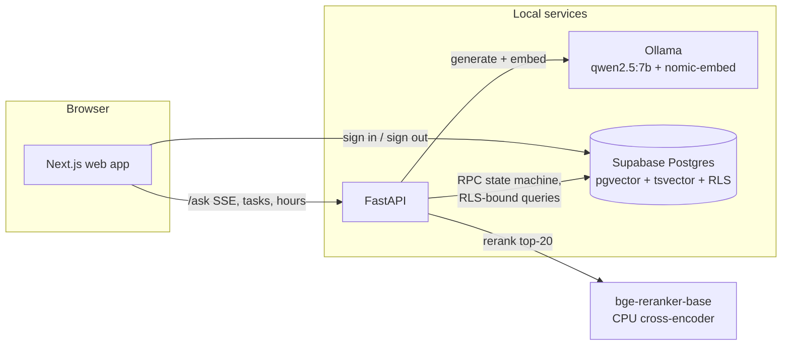

# VetServe Katy

Straight answers about veterans' benefits from official VA and Texas documents — with
sources — and a task board that connects local veterans with verified student
volunteers. Built in Katy, Texas for the 2026 Congressional App Challenge (TX-22).

Two halves, one audience:

- **VetGuide** — ask a question about benefits in plain language and get an answer
  built only from official VA / Texas Veterans Commission documents. Every claim
  carries an inline citation you can expand to the exact source passage. If the
  sources don't cover it, VetGuide says so and points you to a person who can help.
- **Task Board** — verified veterans post small tasks (tech help, yard work, a ride
  to the Katy VA clinic); verified student volunteers claim them, complete them, and
  export a verified PDF of service hours for NHS or school.

Everything runs locally and free: Ollama for the language model and embeddings,
Supabase for the database.

## Local setup

Prerequisites: [Node 20+](https://nodejs.org), [Python 3.11+](https://python.org),
[uv](https://docs.astral.sh/uv/), [Ollama](https://ollama.com), and Docker
(optional — steps 6–7 have a no-Docker alternative).

1. **Clone and configure.**

   ```
   cp .env.example .env
   ```

   You'll fill in the Supabase values in step 3 and the school email domain later.

2. **Create a free Supabase project** at [supabase.com](https://supabase.com).
   In the dashboard: Settings → API. Copy the project URL, the `anon` key, and the
   `service_role` key into `.env`.

3. **Run the migrations** (none yet in Phase 0 — this section activates in Phase 3):
   paste each file from `supabase/migrations/` into the Supabase SQL editor in
   filename order, or use `supabase db push` if you have the CLI.

4. **Pull the models** (one-time, ~5 GB total):

   ```
   ollama pull qwen2.5:7b-instruct
   ollama pull nomic-embed-text
   ```

   Ollama's server runs automatically on `http://localhost:11434` (if not:
   `ollama serve`).

5. **Start with Docker:**

   ```
   docker compose up --build
   ```

   Web on [http://localhost:3000](http://localhost:3000), API on
   [http://localhost:8000](http://localhost:8000). Ollama and Supabase run outside
   compose; the API container reaches Ollama through `host.docker.internal`.

6. **Or start without Docker** (two terminals):

   ```
   cd api
   uv sync
   uv run uvicorn app.main:app --reload
   ```

   ```
   cd web
   npm install
   npm run dev
   ```

7. **Verify.** Open [http://localhost:3000](http://localhost:3000) — the system
   check page shows whether the API, Ollama (and which models are pulled), and
   Supabase are all reachable. The raw report is at
   [http://localhost:8000/health](http://localhost:8000/health).

## Design system

Tokens live in `web/styles/tokens.css`; Tailwind reads only from them. Every
color pair used in the UI is checked against WCAG contrast thresholds by
`scripts/check_contrast.mjs`, which runs before every `npm run dev` and
`npm run build` and fails the build on a regression. All primitives, in all
states, render at [http://localhost:3000/styleguide](http://localhost:3000/styleguide).

## Hosted fallback (optional, demo day only)

If the demo laptop can't run Ollama, set in `.env`:

```
LLM_PROVIDER=groq
GROQ_API_KEY=...   # free tier at console.groq.com
```

Same OpenAI-compatible client, different base URL. The default — and the path
judges should use — is local Ollama.

## Repo layout

```
web/                  Next.js 14 (App Router) + Tailwind, own component library
api/                  FastAPI: VetGuide RAG, task board, hours export
supabase/migrations/  SQL migrations incl. row-level-security policies
scripts/              contrast gate, seed and eval scripts
```

## Architecture



The web app signs users in against Supabase auth directly; every other call
goes through the API carrying the user's JWT, and the API re-issues queries
under that JWT so **row-level security applies to every read**. Task
mutations aren't SQL updates at all — they're `security definer` functions
(`claim_task`, `accept_claim`, …) that validate the caller's role and the
current state inside the database, so the five-step lifecycle can't be
skipped even by a hand-crafted PostgREST request.

## How VetGuide answers (and refuses to make things up)

1. **Crisis gate.** A regex list plus a small model check runs first; a hit
   returns the Veterans Crisis Line (call 988 press 1 / text 838255) and
   skips retrieval entirely.
2. **Hybrid retrieval.** The question is embedded (nomic-embed-text) and run
   against pgvector (top 20, cosine/HNSW) and Postgres full-text search
   (top 20, `websearch_to_tsquery`). The two lists merge by reciprocal rank
   fusion, then `bge-reranker-base` (a cross-encoder, CPU) rescores and keeps
   the best 6 passages.
3. **Generation.** qwen2.5:7b-instruct gets a short system prompt, the 6
   numbered passages, and strict rules: cite every factual sentence `[n]`,
   or output `NO_ANSWER`. Temperature 0.1, 400 tokens max.
4. **Citation validation — the important part.** The answer is split into
   sentences. A sentence citing `[n]` keeps only markers that map to a real
   retrieved chunk; a factual sentence with no citation is embedded and either
   attached to its best-matching chunk (cosine ≥ 0.75) or **deleted**. Every
   deleted sentence is logged to the admin screen with the reason. The UI
   streams raw tokens for responsiveness, then swaps in the validated text —
   nothing unverified persists on screen.
5. **Confidence + handoff.** Low rerank scores replace the answer with "I
   couldn't find this in official sources" and every answer ends with the
   phone number of the relevant office (Fort Bend VSO, TVC, Katy VA clinic —
   all verified against the official pages, see `sources.json`).

## Model choices

- **qwen2.5:7b-instruct** — the strongest instruction-follower we found at a
  size that streams its first token in under ~4 s on a laptop CPU. Swappable
  via one env var (`GENERATION_MODEL`, or `LLM_PROVIDER=groq` for demo-day
  hosted fallback).
- **nomic-embed-text** — 768-dim, open weights, runs in the same Ollama
  instance, no separate Python model downloads.
- **bge-reranker-base** — a cross-encoder reranker lifts the right document
  into the top 3 far more reliably than either retriever alone; top-20 on CPU
  costs well under a second.

## Limitations

- VetGuide only knows the ~15 ingested documents (`sources.json`); anything
  outside them gets an honest "couldn't find this" — by design.
- A 7B model can misread a passage even with real citations attached; the
  validator guarantees provenance, not perfect interpretation. The sources
  are always one tap away, and every screen points at a human.
- Verification is lightweight (self-attest + admin approval + school email
  domain); it deters casual misuse, not a determined bad actor.
- English only, for now.
- On a laptop **without a GPU**, a 7B model answers in about a minute or two
  (CPU prompt processing dominates). With any recent GPU it's seconds. For a
  fast live demo on CPU-only hardware, use the `LLM_PROVIDER=groq` fallback.

## Responsible use

VetGuide is **not** legal, medical, or financial advice, and says so in the
UI. Crisis queries bypass the model pipeline for the Veterans Crisis Line.
Addresses are never public: they live in a separate table whose RLS policy
only matches the posting veteran and the one accepted volunteer. Feedback is
anonymous. Only official government documents are ingested, each recorded
with URL, fetch date, and hash in `sources.json` — the app never invents a
source, and drops any sentence it can't back.

## Demo accounts (after `seed_demo.py`)

All passwords: `demo-password-1` — admin `admin@demo.local`, veterans
`vet.alvarez@demo.local` / `vet.okafor@demo.local` / `vet.nguyen@demo.local`,
students `priya.n@demo.local` / `marcus.j@demo.local` / `elena.r@demo.local`.
